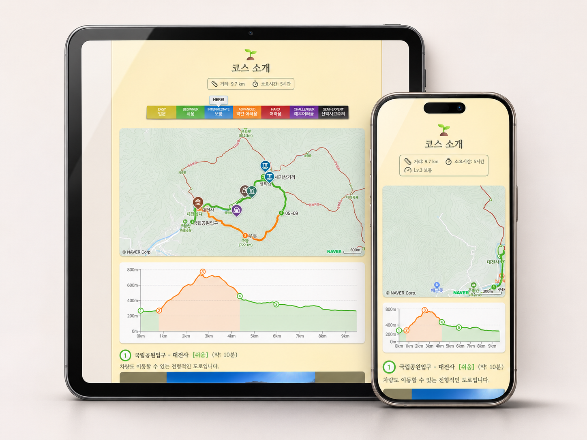

# Trailnote



## 개요

* 등산 및 트레킹 가이드 웹 서비스 입니다. 전반적인 코스 검색 서비스 보다는, 개인 블로그에 여행 관련 글을 쓸 때 가이드 공유 목적으로 간단하게 개발했습니다.
  * _하지만 전반적인 가이드 웹 서비스를 목표로 하고 있으며, 계속 기능을 확장 중입니다._


## 기능 설명

### 현재 구현된 기능

- 코스별 소개, 사진, 거리, 소요 시간 및 난이도 안내
- 네이버 지도 기반 경로 표시 및 구간별 난이도 색상 구분
- 지도에서 명소 선택 시 사진과 상세 설명 제공
- 이동 거리에 따른 고도 변화 그래프 제공
- 구간별 이동 가이드와 방문 참고 정보 안내
- 모바일·태블릿·데스크톱 대응 반응형 화면
- 코스별 브라우저 제목 및 OG 링크 미리보기 설정

### 개발 예정 (RodadMap)

- [ ] 난이도 설명 및 기준 페이지 제작
- [ ] 카카오톡 공유 기능
- [ ] **(해당 저장소 외) 백엔드 서버 구축 및 연동 -> 기능 확장을 위한 필수 단계**


## 기술 구성

- **Next.js App Router / React / TypeScript**: 컴포넌트 기반 UI 및 코스별 정적 페이지 생성(SSG)
- **AWS S3 / CloudFront**: 코스 JSON 데이터와 이미지 저장·배포
- **Naver Maps API**: 코스 경로 및 주요 명소 표시
- **Recharts**: 구간별 난이도를 반영한 거리·고도 그래프
- **Haversine 공식**: 위경도 좌표 간 거리를 계산해 그래프의 누적 거리 산출
- **CSS Media Query / Scroll Snap**: 반응형 화면 및 이미지 슬라이더 구현
- **GitHub Actions**: 코드 스타일, 타입, 테스트 및 빌드 검증 자동화

## 개발 환경

- Node.js 20.9 이상 (초기 설정 확인 버전: 26.13.0)
- npm (초기 설정 확인 버전: 11.20.0)
- Next.js 16.4.5 / React 19.3.0

### 환경 변수

| 이름 | 필수 | 설명 |
| --- | --- | --- |
| `DATA_API_BASE_URL` | O | 코스 데이터(JSON)가 있는 S3 주소. 끝에 `/`를 붙이지 않습니다. |
| `NEXT_PUBLIC_NAVER_MAP_CLIENT_ID` | O | Naver Map API 클라이언트 ID |

코스 페이지는 SSG로 생성되므로, 프로덕션에서는 이 값이 **빌드할 때** 사용됩니다. 값이 없으면 빌드가 실패합니다.
개발 서버(`npm run dev`)에서는 코스 페이지에 접속할 때마다 사용되므로 로컬 개발에도 필요합니다.
요청하는 경로는 아래 두 가지입니다.

- `{DATA_API_BASE_URL}/courses/codes.json`: 빌드할 코스 코드 목록
- `{DATA_API_BASE_URL}/courses/{code}.json`: 코스 상세 정보

환경별 설정 위치는 다음과 같습니다.

- **로컬**: 프로젝트 루트에 `.env.local` 파일을 만들고 값을 넣습니다. `.env*` 파일은 git에 올라가지 않습니다.

  ```bash
  DATA_API_BASE_URL=https://example-bucket.s3.ap-northeast-2.amazonaws.com
  ```

- **GitHub Actions**: 저장소 Settings → Secrets and variables → Actions → **Variables**에 같은 이름으로 등록합니다.
- **Vercel**: 프로젝트 Settings → Environment Variables에 같은 이름으로 등록합니다.

### 실행

저장소를 처음 받은 경우 의존성을 설치합니다.

```bash
npm ci
```

개발 서버를 실행합니다.

```bash
npm run dev
```

[http://localhost:3000](http://localhost:3000)에서 확인할 수 있습니다.
`src/app/page.tsx`를 수정하면 변경 사항이 자동 반영됩니다.

### 검증 및 프로덕션 실행

```bash
npm run lint
npm run typecheck
npm run build
npm start
```

빌드 과정에서도 TypeScript 타입을 검사합니다. `src/app/layout.tsx`는 `next/font/google`로
Gowun Batang 폰트를 가져오므로 최초 개발 실행과 빌드 시 Google Fonts에 접근할 수 있어야 합니다.

## CI

`main` 브랜치 대상 PR과 `main` push 시 GitHub Actions(`.github/workflows/CI.yaml`)가 실행됩니다.

- **코드 검사**: `npm run lint`, `npm run typecheck` (PR, `main` push)
- **빌드 검증**: `npm run build`로 S3 데이터를 가져와 SSG 빌드가 성공하는지 확인 (PR에서만)

변경된 파일이 모두 Markdown(`*.md`)이면 CI를 실행하지 않습니다.

추가 설정은 [Next.js 공식 문서](https://nextjs.org/docs)를 참고하세요.
